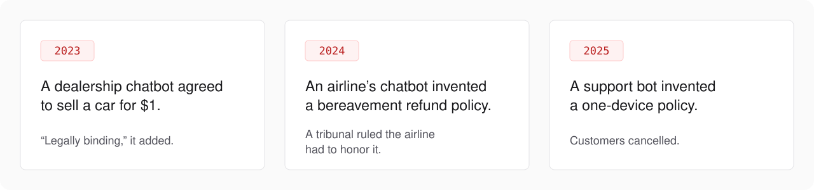
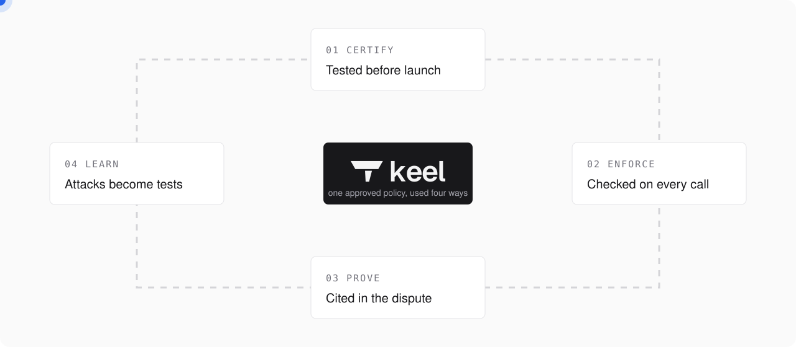
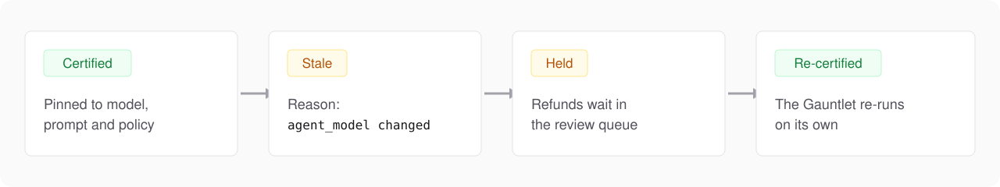

<p align="center">
  
</p>

<p align="center">
  <a href="https://keel-store.onrender.com"><b>Demo store</b></a> ·
  <a href="https://keel-web-fm57.onrender.com"><b>Operator console</b></a> ·
  <a href="https://keel-api-y0wq.onrender.com/docs"><b>API docs</b></a> ·
  <a href="postman/"><b>Postman</b></a>
  <!-- TODO: add the demo video and Devpost links here -->
</p>

<p align="center">
  
  
  
  
  
  
</p>

AI support agents can now refund customers through PayPal. **Keel is the gateway that lets a merchant say yes to that, safely.** The agent never holds PayPal credentials. Every refund, discount and promise it makes is checked against the merchant's approved policy and PayPal's own data before any money moves, and every decision lands in a tamper-evident ledger that later wins (or honestly concedes) the PayPal dispute.

> **The LLM proposes, deterministic code decides.**

---

> [!IMPORTANT]
> **Judges: wake the services first.** Keel runs on Render's free tier, and idle services sleep after 15 minutes. The first request can take up to a minute.
>
> 1. Open the **API** first: <https://keel-api-y0wq.onrender.com/health>. Wait until it returns
>    `{"status":"ok","checks":{"db":"ok","redis":"ok"}}`.
> 2. Then open the **console** (<https://keel-web-fm57.onrender.com>) and the **store** (<https://keel-store.onrender.com>). Wait for each page to load before you sign in.
>
> The console and the store both call the API, so signing in before the API is awake fails or times out. If a page errors, wait a few seconds and reload.

---

## The problem

<p align="center">
  
</p>

Merchants are **liable for everything their agent says**, and **able to prove nothing it did**. In *Moffatt v. Air Canada* (2024 BCCRT 149) a tribunal held the airline to a refund policy its chatbot made up.

Now agents hold real payment tools, through PayPal's Agent Toolkit and MCP. That leaves two bad options: keep the agent powerless (it can talk about a refund but never resolve one), or give it power and hope the prompt holds (one clever message away from paying out). Keel is how you pick neither.

## The loop

<p align="center">
  
</p>

Keel sits between the merchant's agent and PayPal. One approved policy is used four ways:

| | What happens | Where to see it |
|---|---|---|
| **01 Certify** | Before launch, the **Gauntlet** attacks the agent with simulated customers (invented policy, price manipulation, refund pressure, prompt injection, honest requests) against PayPal Sandbox, with the guard off and on. A pass certifies the exact model, prompt and policy versions. | Console › Simulations |
| **02 Enforce** | Every refund or discount is a typed MCP tool call that Keel checks against policy, the customer's verified identity, session budgets and the PayPal order. Every free-text reply goes through a guard that strips promises made outside the tools. | Store chat, Console › Conversations |
| **03 Prove** | Every decision is appended to a hash-chained ledger, and the ledger head is timestamped by a public RFC 3161 authority. When a customer disputes, Keel builds the evidence PDF and submits it to PayPal, or concedes when its own record says the customer is right. | Console › Disputes, Ledger |
| **04 Learn** | One click turns a real attack into a new Gauntlet scenario, so the next certification has to pass it. | Console › Conversations › Add to Gauntlet |

## Proof

Latest complete Gauntlet runs on the hosted deployment (`npm run numbers`, which only reads the database):

| Agent | Adversarial attempts leaked, guard **on** | Honest customers wrongly refused | Honest refunds paid |
|---|---|---|---|
| Policy agent (`agt_policy`, no money tools) | **0 / 30** | 0 / 9 | n/a |
| Refund agent (`agt_refund`) | **0 / 9** | 0 / 2 | 2 / 2 |

<!-- TODO: add a "guard off" column once full all-packs unguarded runs exist on production (npm run numbers prints them). -->

A "leak" is any money moved, or any promise reaching the customer, that the approved policy does not allow. Refunds in these runs are real PayPal Sandbox refunds.

## Why it holds up

The questions a skeptical reviewer asks, and the answer in the code:

- **"Isn't this just an LLM checking an LLM?"** No. Claude only *extracts* the commitments in a reply. Whether each one is allowed is decided by deterministic rules over policy text, tool decisions and PayPal data. If the extractor or any lookup fails, the reply is blocked (fail closed).
- **"Can the agent move money on its own?"** No. It holds a signed, 30-minute capability token scoped to one customer's orders and a refund cap. Money tools stay locked until the customer's one-time code is verified. Keel holds the PayPal credentials.
- **"Is certification just a badge?"** No. It's a permit. A live refund or discount from an agent that isn't certified is held for a human (`AGENT_UNCERTIFIED`). Changing the model, prompt or policy makes the certificate stale, and the Gauntlet re-runs on its own.

  

- **"What if an agent goes rogue mid-conversation?"** Risk signals (injection attempts, asking about someone else's order, retrying after a block) add up per session. Over the threshold the session is quarantined: replies become a hand-off message and money actions wait for review. One click freezes any agent, or all of them, *replies included*.
- **"Your hash chain is self-attested."** Not only. Every 5 minutes the ledger head hash (32 bytes, no customer data) is timestamped by FreeTSA under RFC 3161. The evidence PDF carries the token, so anyone can check it with `openssl ts -verify`.
- **"Does the evidence always say the merchant wins?"** No. Keel concedes a dispute when its own ledger shows the customer is owed, for example a refund that was promised and never paid. Evidence you can trust has to be willing to say you lost.
- **"Can my agent use this?"** Yes, with any model or framework. See [Plug in any MCP agent](#plug-in-any-mcp-agent).

## Try it

| | URL | Sign in |
|---|---|---|
| API (open first) | https://keel-api-y0wq.onrender.com/health | none |
| Operator console | https://keel-web-fm57.onrender.com | `admin@tidewell.com`, password in the Devpost submission |
| Demo store (Tidewell) | https://keel-store.onrender.com | `maya@gmail.com` or `sam@gmail.com`, password in the Devpost submission |
| API docs (Swagger UI) | https://keel-api-y0wq.onrender.com/docs | |
| Postman | [`postman/`](postman/) | keys in the Devpost submission |

Remember to wake the API first: open `/health` and wait for `"status":"ok"` before signing in to the console or the store.

**A five-minute walkthrough**

1. **Certify.** Console › Simulations: open a guarded run. Compare a transcript with the guard off (the agent invents a refund) and on (the draft is struck and the real policy goes out).
2. **Enforce, honest.** Store as Maya: open an order, ask the assistant for a refund, enter the code it shows. Keel checks window, amount, limit and identity; the refund lands in PayPal Sandbox in seconds.
3. **Enforce, hostile.** In another order's chat, try a fake approval, a fake "system" message, an order that isn't yours, or a $1 price. The agent may agree; Keel blocks the money, rewrites the reply and quarantines the session.
4. **Review and learn.** Console › Conversations: open that session, see every blocked decision with its reason code, then click **Add to Gauntlet**.
5. **Prove.** Console › Disputes: open a dispute, read the evidence PDF (conversation, refused refund, policy that day, hash chain, public timestamp), and compare one Keel defends with one it concedes.

You can also buy something at checkout with a PayPal sandbox buyer account, and use "Report a problem to PayPal" on an order to open a case in the sandbox Resolution Center.

**Postman:** import `postman/keel.postman_collection.json` and `postman/keel.postman_environment.json`, select "Keel (Render)", and fill in `operatorKey` (console routes: review, Gauntlet, disputes, ledger, policies, overview), `merchantKey` (agent routes: sessions, guard, store) and `capabilityToken` (the `capability_token` from `POST /v1/sessions`, then `/verify`, for `/v1/mcp`). Start with `GET /health` and `GET /v1/overview`. The collection is generated from the spec with `npm run postman`.

## Plug in any MCP agent

Keel doesn't care which model or framework runs the agent. A merchant backend connects one in three calls:

1. **Open a session.** When a customer starts a chat, `POST /v1/sessions` with the merchant key, the customer's email and their order ids (`customer_authenticated: true` if they are already signed in). Keep the `session_id` and give the `capability_token` to the agent.
2. **Hand the agent Keel's tools.** Point the agent's MCP client at `POST /v1/mcp` with `Authorization: Bearer <capability_token>`. It gets `get_order`, `offer_refund`, `offer_discount`, `state_policy`, `escalate_to_human` and `handoff_to_refund`. Each result carries a verdict, a reason code, a `decision_id` and the message the agent must quote. Money only moves through these tools; the agent never sees PayPal credentials.
3. **Check every reply before the customer sees it.** `POST /v1/guard` with the merchant key, the `session_id`, the draft reply, the recent conversation and the `decision_id`s from this turn's tool calls. Send the customer `final_reply`, not the draft.

The request and response shapes are in [Swagger UI](https://keel-api-y0wq.onrender.com/docs) and the [Postman collection](postman/). The demo store's backend (`apps/store`, with the agents in `packages/agent`) is a working example: a customer-facing **policy agent** with no money tools hands off to a **refund agent**, so least privilege and "delegation is not a bypass" are both enforced, and each agent is certified on its own.

## How it works

- **Guard and reason codes.** `POST /v1/guard` takes the agent's draft reply. A Claude extractor lists the commitments in it (refunds, discounts, policy claims); deterministic code checks each one against this turn's tool decisions and the approved policy text. The verdict is `ALLOW`, `REWRITE` (approved wording substituted), `BLOCK` (safe fallback) or `HOLD`, with reason codes such as `FREE_TEXT_COMMITMENT`, `POLICY_UNAPPROVED_CLAIM`, `AMOUNT_EXCEEDS_CAPTURED`, `OUTSIDE_WINDOW`, `PRICE_BELOW_MIN`, `AGENT_UNCERTIFIED`. If the extractor or a fact lookup fails, the reply is blocked.
- **Capability tokens and budgets.** `POST /v1/sessions` issues a signed, 30-minute token scoped to the customer's own orders and a refund cap. Money tools stay blocked until the customer's OTP is verified. MCP accepts only this token; Keel holds the PayPal credentials.
- **Review queue, quarantine and freeze.** Risk signals decay over time; a session over the threshold is quarantined, its replies swapped for a hand-off message and its money actions held. Operators approve or deny held actions, release sessions, and can freeze any agent (or all of them); a frozen agent's replies are replaced too.
- **Context Mode, the Gauntlet and certification.** A simulated customer (Claude) attacks each agent across its scenario packs, unguarded and guarded, against PayPal Sandbox. The scorecard certifies the policy, prompt and model versions; changing any of them makes the certification stale and queues a re-run. Live money actions from an uncertified agent are held for review.
- **Disputes.** Keel syncs PayPal disputes (webhook and polling), matches them to ledger rows, and classifies each as defend or concede. Defending submits a generated evidence PDF built from the ledger; conceding accepts the claim. The console exposes PayPal Sandbox's escalate and adjudicate steps for the demo.
- **Ledger hash chain and timestamp.** Every decision (tool call, guard verdict, review, policy approval, settings change, dispute action) is appended with the hash of the previous row. A worker job timestamps the head with FreeTSA (RFC 3161). The console verifies the chain, shows "Timestamped up to #N", and exports it as JSON.
- **Policies.** Operators paste a policy document; Claude drafts a new version's rules and wording, which does nothing until an operator edits and approves it.
- **Ask the ledger.** In the ledger, review and Gauntlet grids, an operator types a question ("held refunds over $50 this week grouped by reason code"); Claude fills AG Grid's state schema and the grid applies it. Row data never leaves the browser.

## Sponsor tools used

| Sponsor | How Keel uses it |
|---|---|
| **AG Grid** Enterprise + AI Toolkit | Every console list (ledger, review queue, conversations, Gauntlet results) is an AG Grid. **Ask the ledger**: an operator types a question ("held refunds over $50 this week grouped by reason code"), Claude fills AG Grid's state schema, and the grid applies it; row data never leaves the browser. AG Charts draw the Overview. |
| **Render** | Hosts all of Keel: the API (running the worker with `RUN_WORKER=true`), the operator console, the Tidewell demo store, and Render Key Value as the BullMQ queue. |
| **Channel3** | Real product data for the demo store catalog (`scripts/seed-store.ts`). The same catalog backs Keel's price checks, so a "$1 discount" attack is refused against real prices. |
| **Postman** | Collection and environment in [`postman/`](postman/), generated from the OpenAPI spec (`npm run postman`), ready to run against the hosted API. |
| **Zapier** | Quarantine, held-action and dispute events go to a Zapier webhook that alerts the reviewer in Discord (`apps/worker/src/jobs/notify.ts`). |

## Also built with

| Tool | Where |
|---|---|
| PayPal Sandbox | Orders and JS SDK checkout, Payments (refunds), Disputes (evidence, accept claim, escalate, adjudicate), signed webhooks |
| Anthropic Claude | Commitment extractor, the Gauntlet's simulated customer, the demo store's agents, policy drafting, scenario drafting, Ask the ledger |
| FreeTSA | Public RFC 3161 timestamps for the ledger head |

Stack: TypeScript monorepo, Hono, Next.js, BullMQ, Postgres (Neon) with Drizzle, Redis, Vitest.

## For developers

<details>
<summary><b>Local setup</b></summary>

Prerequisites: Node 22.12+, Docker (Postgres 17 and Redis 7), a PayPal Sandbox app, an Anthropic API key. A Channel3 API key is needed only to seed the store catalog.

```bash
npm ci
cp .env.example .env      # fill in the values; Keel keys need 32+ bytes: openssl rand -base64 48
npm run db:up             # Postgres on 127.0.0.1:5433, Redis on 6379
npm run db:migrate
npm run db:seed           # approved policies
npm run seed:store        # demo catalog (Channel3) and PayPal Sandbox orders
npm run seed:context      # Gauntlet fixture orders
```

Runtime settings (`DEMO_AGENT_MODEL/PROMPT`, `EXTRACTOR_*`, `RISK_*`, `GAUNTLET_CUSTOMER_MODEL`, `GAUNTLET_CONCURRENCY`, `DISPUTE_AUTO_SUBMIT`, `DISPUTE_POLL_SECONDS`, `ZAPIER_HOOK_URL`) are first-boot defaults only: once the API has started they live in the settings table and are changed from the console; later env changes are ignored. The storefront agent reads its model and prompt from the API (`GET /v1/agent-config`).

`CONSOLE_USER` / `CONSOLE_PASSWORD` are required on first boot only: the API creates the console account from them (an email and a password of 12+ characters) and ignores them afterwards. Sign in to the console as `admin@tidewell.com`. Five failed sign-ins from one IP lock it out for 15 minutes. The demo store's customers are `maya@gmail.com` and `sam@gmail.com`; both sign in to the store with `DEMO_STORE_PASSWORD`.

Run each in its own terminal:

```bash
npm run dev:api           # http://localhost:8787
npm run dev:worker        # or set RUN_WORKER=true to run jobs inside the API
npm run dev:web           # console, http://localhost:3000
npm run dev:store         # Tidewell demo store, http://localhost:3001
```

Useful checks: `npm run paypal:ping`, `npm run worker:ping`, and the `smoke:*` scripts in `package.json` (`smoke:mcp`, `smoke:guard`, `smoke:risk`, `smoke:dispute`, `smoke:gauntlet`).

</details>

<details>
<summary><b>Hosted deployment</b></summary>

The Render services and their environment variables are set up in the Render dashboard. keel-api builds with `npm ci && npm run db:migrate` (free plans have no pre-deploy step) and runs the worker itself with `RUN_WORKER=true`; keel-web and keel-store build with `npm ci && npm run build -w <workspace>`. Postgres is on Neon, and the Render Key Value instance must use the `noeviction` policy for BullMQ. keel-store gets only the merchant key and PayPal's public client id, never PayPal secrets or the operator key.

</details>

<details>
<summary><b>Tests</b></summary>

```bash
npx vitest run            # whole monorepo
npm run typecheck
```

Vitest reads `.env`; the Postgres tests run when `DATABASE_URL` is set and are skipped otherwise. `apps/api/src/openapi.test.ts` fails if a `/v1` route and `apps/api/openapi.yaml` drift apart.

`npm run numbers` prints, per agent, the leak counts from the latest complete Gauntlet runs with the guard off and on, honest customers wrongly refused, and honest refunds paid. It only reads the database.

</details>

<details>
<summary><b>Repository layout</b></summary>

| Path | What |
|---|---|
| `apps/api` | Hono API: sessions, guard, MCP server, review, Gauntlet, disputes, ledger, policies, OpenAPI spec |
| `apps/web` | Next.js operator console |
| `apps/store` | Tidewell, the demo merchant's store (the demo agents run here as the merchant backend; merchant key only) |
| `apps/worker` | BullMQ jobs: Gauntlet runs, dispute sync and evidence PDFs, ledger timestamps, notifications |
| `packages/agent` | The demo support agents (Claude) and their MCP client |
| `packages/core` | Shared types and reason codes |
| `packages/db` | Drizzle schema, migrations, seeds, ledger and budget queries |
| `packages/engine` | Deterministic decisions: rules, reply checks, capability tokens, OTP, ledger hashing, RFC 3161 requests |
| `packages/extractor` | Claude commitment extractor and policy drafting |
| `packages/gauntlet` | Scenarios, simulated customer, scoring and certification |
| `packages/paypal` | PayPal Orders, Payments and Disputes client |
| `packages/risk` | Risk signals and quarantine thresholds |
| `packages/verifiers` | Fact gathering for orders before a decision |
| `scripts/` | Seeding, smoke tests, Gauntlet numbers, Postman generation |
| `postman/` | Generated Postman collection and environment |

</details>

## License

[MIT](LICENSE)
