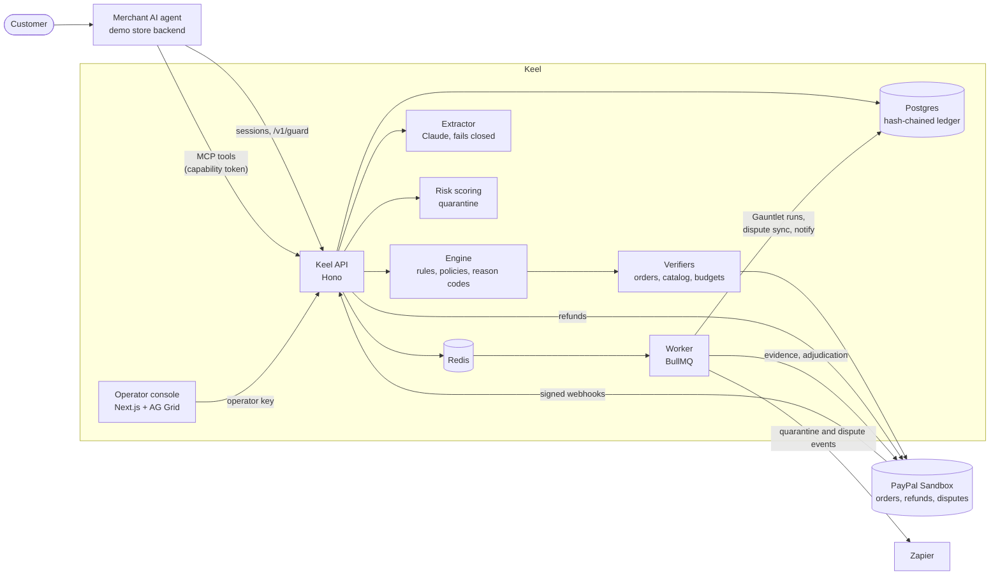

# Keel

Keel is a commitment gateway between a merchant's AI support agent and PayPal. The agent never holds PayPal credentials: refunds and discounts are typed MCP tool calls that Keel checks against approved policy, the customer's verified identity, session budgets and PayPal's own data before any money moves. Free-text replies go through a guard that catches promises made outside the tools and rewrites or blocks them. Every decision lands in a hash-chained ledger, and that ledger becomes the evidence Keel submits when a customer opens a PayPal dispute. Before an agent goes live, Context Mode runs it through the Gauntlet, an adversarial test suite against PayPal Sandbox, and certifies the exact policy, prompt and model versions it passed with.

**The LLM proposes, deterministic code decides.**

## Try it

| | |
|---|---|
| Operator console | https://keel-web-fm57.onrender.com (login `admin@tidewell.com`; password: see the Devpost submission) |
| Demo store (Tidewell) | https://keel-store.onrender.com (sign in as `maya@gmail.com` or `sam@gmail.com`; password: see the Devpost submission) |
| API | https://keel-api-y0wq.onrender.com |
| API docs (Swagger UI) | https://keel-api-y0wq.onrender.com/docs |
| OpenAPI 3.1 spec | https://keel-api-y0wq.onrender.com/openapi.yaml |
| Postman | [`postman/`](postman/) |

The hosted services run on Render's free tier and sleep after 15 minutes idle; the first request can take up to a minute.

**Postman:** import `postman/keel.postman_collection.json` and `postman/keel.postman_environment.json`, select the "Keel (Render)" environment, and fill in:

- `operatorKey` for the console routes (review queue, Gauntlet, disputes, ledger, policies, overview);
- `merchantKey` for the agent-side routes (sessions, guard, store);
- `capabilityToken` for `/v1/mcp`: the `capability_token` returned by `POST /v1/sessions` (then `/verify`).

Keys are not published here; see the Devpost submission. Start with `GET /health` (no auth) and `GET /v1/overview`. The collection is generated from the spec with `npm run postman`.

## Architecture



## How it works

- **Guard and reason codes.** `POST /v1/guard` takes the agent's draft reply. A Claude extractor lists the commitments in it (refunds, discounts, policy claims); deterministic code checks each one against this turn's tool decisions and the approved policy text. The verdict is `ALLOW`, `REWRITE` (approved wording substituted), `BLOCK` (safe fallback) or `HOLD`, with reason codes such as `FREE_TEXT_COMMITMENT`, `POLICY_UNAPPROVED_CLAIM`, `AMOUNT_EXCEEDS_CAPTURED`, `OUTSIDE_WINDOW`, `PRICE_BELOW_MIN`. If the extractor or a fact lookup fails, the reply is blocked.
- **Capability tokens and budgets.** `POST /v1/sessions` issues a signed, 30-minute token scoped to the customer's own orders and a refund cap. Money tools stay blocked until the customer's OTP is verified. MCP accepts only this token; Keel holds the PayPal credentials.
- **Review queue and quarantine.** Risk signals (injection attempts, asking about someone else's order, retrying after a block) decay over time; a session over the threshold is quarantined, its replies swapped for a hand-off message and its money actions held. Operators approve or deny held actions, release sessions, and can freeze any agent (or all of them).
- **Context Mode, the Gauntlet and certification.** A simulated customer (Claude) attacks the demo agent across scenario packs (invented policy, price manipulation, refund pressure, prompt injection, honest requests), unguarded and guarded, against PayPal Sandbox. The scorecard certifies the policy, prompt and model versions; changing any of them makes the certification stale. A real attack can be turned into a new scenario with "Add to Gauntlet".
- **Disputes.** Keel syncs PayPal disputes (webhook and polling), matches them to ledger rows, and classifies each as defend or concede. Defending submits a generated evidence PDF built from the ledger; conceding accepts the claim. The console exposes PayPal Sandbox's escalate and adjudicate steps for the demo.
- **Ledger hash chain.** Every decision (tool call, guard verdict, review, policy approval, dispute action) is appended with the hash of the previous row. The console verifies the chain and exports it as JSON.
- **Policies.** Operators paste a policy document; Claude drafts a new version's rules and wording, which does nothing until an operator edits and approves it.
- **Ask the ledger.** In the ledger, review and Gauntlet grids, an operator types a question ("held refunds over $50 this week grouped by reason code"); Claude fills AG Grid's state schema and the grid applies it. Row data never leaves the browser.

## Demo script (under 3 minutes)

1. **Console:** policies approved; a Gauntlet run in Context Mode shows the unguarded agent leaking and the guarded one certified.
2. **Live chat:** an honest refund request is allowed and refunded in PayPal Sandbox; a bereavement-style request outside policy gets its reply rewritten to the real policy.
3. **Attack:** a $1 discount manipulation plus prompt injection raises the risk score, the session is quarantined, the refund is held, a reviewer denies it and adds the conversation to the Gauntlet.
4. **Dispute:** a sandbox dispute arrives, Keel builds evidence from the ledger, submits it, and sandbox adjudication goes the merchant's way.
5. **Overview:** dollars protected, violations caught, disputes won.

## Local setup

Prerequisites: Node 22.12+, Docker (Postgres 17 and Redis 7), a PayPal Sandbox app, an Anthropic API key. A Channel3 API key is needed only to seed the store catalog.

```bash
npm ci
cp .env.example .env      # fill in the values; Keel keys need 32+ bytes: openssl rand -base64 48
npm run db:up             # Postgres on 127.0.0.1:5433, Redis on 6379
npm run db:migrate
npm run db:seed           # approved policies
npm run seed:store        # demo catalog (Channel3) and PayPal Sandbox orders
npm run seed:context      # Gauntlet fixture orders
```

Runtime settings (`DEMO_AGENT_MODEL/PROMPT`, `EXTRACTOR_*`, `RISK_*`, `GAUNTLET_CUSTOMER_MODEL`, `GAUNTLET_CONCURRENCY`, `DISPUTE_AUTO_SUBMIT`, `DISPUTE_POLL_SECONDS`, `ZAPIER_HOOK_URL`) are first-boot defaults only: once the API has started they live in the settings table and are changed from the console; later env changes are ignored. The storefront agent reads its model and prompt from the API (`GET /v1/agent-config`).

`CONSOLE_USER` / `CONSOLE_PASSWORD` are required on first boot only: the API creates the console account from them (an email and a password of 12+ characters) and ignores them afterwards. Sign in to the console as `admin@tidewell.com`. Five failed sign-ins from one IP lock it out for 15 minutes. The demo store's customers are `maya@gmail.com` and `sam@gmail.com`; both sign in to the store with `DEMO_STORE_PASSWORD`.

Run each in its own terminal:

```bash
npm run dev:api           # http://localhost:8787
npm run dev:worker        # or set RUN_WORKER=true to run jobs inside the API
npm run dev:web           # console, http://localhost:3000
npm run dev:store         # Tidewell demo store, http://localhost:3001
```

Store walkthrough: sign in as Maya, open an order under Orders and ask the support assistant for a refund (enter the demo code it shows to verify first); buy something at checkout with a PayPal sandbox buyer account or test card; use "Report a problem to PayPal" on an order to open a case in the sandbox Resolution Center. Every agent decision shows up in the console under Conversations and the Ledger.

Useful checks: `npm run paypal:ping`, `npm run worker:ping`, and the `smoke:*` scripts in `package.json` (`smoke:mcp`, `smoke:guard`, `smoke:risk`, `smoke:dispute`, `smoke:gauntlet`).

Hosted deployment: the Render services and their environment variables are set up in the Render dashboard. keel-api builds with `npm ci && npm run db:migrate` (free plans have no pre-deploy step) and runs the worker itself with `RUN_WORKER=true`; keel-web and keel-store build with `npm ci && npm run build -w <workspace>`. Postgres is on Neon, and the Render Key Value instance must use the `noeviction` policy for BullMQ. keel-store gets only the merchant key and PayPal's public client id, never PayPal secrets or the operator key.

## Tests

```bash
npx vitest run            # whole monorepo
npm run typecheck
```

Vitest reads `.env`; the Postgres tests run when `DATABASE_URL` is set and are skipped otherwise. `apps/api/src/openapi.test.ts` fails if a `/v1` route and `apps/api/openapi.yaml` drift apart.

## Sponsor tools used

| Tool | Where |
|---|---|
| AG Grid Enterprise + AI Toolkit | Console grids (ledger, review queue, Gauntlet results) and "Ask the ledger"; AG Charts on the Overview |
| Render | Hosts the API (with the worker), the console, the demo store and Redis |
| Channel3 | Product data for the demo store catalog (`scripts/seed-store.ts`); the catalog backs the price checks |
| Postman | Collection and environment in `postman/`, generated from the OpenAPI spec |
| Zapier | Quarantine, held-action and dispute events go to a Zapier webhook that notifies the reviewer (`apps/worker/src/jobs/notify.ts`) |

Anthropic's Claude models power the extractor, the Gauntlet's simulated customer, the demo store agent, policy drafting, scenario drafting and Ask the ledger. PayPal Sandbox handles orders, refunds and disputes.

## Repository layout

| Path | What |
|---|---|
| `apps/api` | Hono API: sessions, guard, MCP server, review, Gauntlet, disputes, ledger, policies, OpenAPI spec |
| `apps/web` | Next.js operator console |
| `apps/store` | Tidewell, the demo merchant's store (the demo agent runs here as the merchant backend; merchant key only) |
| `apps/worker` | BullMQ jobs: Gauntlet runs, dispute sync and evidence PDFs, notifications |
| `packages/agent` | The demo support agent (Claude) and its MCP client |
| `packages/core` | Shared types and reason codes |
| `packages/db` | Drizzle schema, migrations, seeds, ledger and budget queries |
| `packages/engine` | Deterministic decisions: rules, reply checks, capability tokens, OTP, ledger hashing |
| `packages/extractor` | Claude commitment extractor and policy drafting |
| `packages/gauntlet` | Scenarios, simulated customer, scoring and certification |
| `packages/paypal` | PayPal Orders, Payments and Disputes client |
| `packages/risk` | Risk signals and quarantine thresholds |
| `packages/verifiers` | Fact gathering for orders before a decision |
| `scripts/` | Seeding, smoke tests, Postman generation |
| `postman/` | Generated Postman collection and environment |
